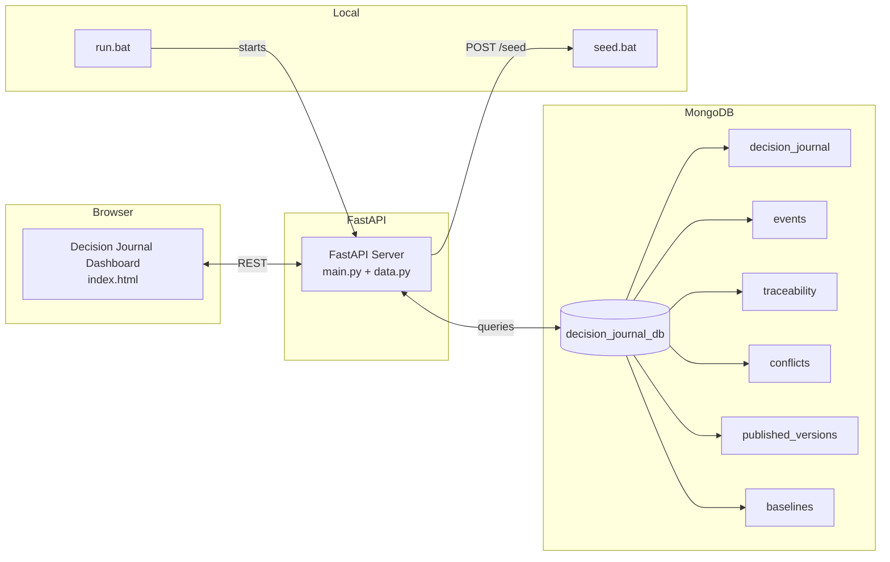

# Decision Journal Dashboard

**A governance and traceability platform for AI/ML decision-making, conflict resolution, and release management.**

The Decision Journal Dashboard is a single-repo monorepo that combines a **FastAPI backend with MongoDB** and a **vanilla JavaScript frontend** into one deployable unit. It tracks requirements baselines, decision records, conflicts, traceability events, and published release versions — all in one live dashboard.

---

## Table of Contents

1. [Overview](#overview)
2. [Architecture](#architecture)
3. [Repository Structure](#repository-structure)
4. [Data Model](#data-model)
5. [Getting Started](#getting-started)
6. [Running the Dashboard](#running-the-dashboard)
7. [API Endpoints](#api-endpoints)
8. [Dashboard Features](#dashboard-features)
9. [Seed Data](#seed-data)
10. [Deployment](#deployment)
11. [Configuration](#configuration)
12. [Troubleshooting](#troubleshooting)
13. [Contributing](#contributing)
14. [License](#license)

---

## Overview

This repository implements a **Decision Journal** — a living record of architectural and project decisions, the conflicts they resolve, and the release versions they produce. It is designed to be:

- **100% working out of the box** — clone, run `run.bat`, and the dashboard opens automatically.
- **Self-contained** — MongoDB + FastAPI + single-page frontend, no external build step required.
- **Traceable** — every requirement links to its test file and documentation, every conflict has a resolution with an owner and timestamp.
- **Versioned** — published release versions (`v1.0.0`, `v1.1.0`, `v1.2.0`) are stored with their baselines and decisions.

The dashboard is built for **ARRA** (a conceptual engineering/construction firm), but the data model is generic enough to apply to any product with requirements, decisions, conflicts, and releases.

## Architecture

The system follows a **thin frontend / thick data** architecture:



**Flow:**

1. `run.bat` creates a Python virtual environment, installs dependencies, and launches `uvicorn` serving both the **FastAPI API** and the **static frontend** (`frontend/index.html`).
2. The frontend is a single HTML file with embedded CSS and vanilla JavaScript — no build step, no bundler, no framework runtime.
3. All data lives in **MongoDB** under the `decision_journal_db` database.
4. `seed.bat` POSTs to `POST /seed` to populate the database with **4 baselines, 7 requirements, 10 decisions, 5 conflicts, 3 published versions, and 45+ traceability events**.

---

## Repository Structure

```text
kiyan/jl/decision-journal/
│
├── README.md                     # This file
├── docker-compose.yml            # MongoDB service for local dev / Docker
├── run.bat                       # Launcher (Windows) — starts backend + opens dashboard
├── seed.bat                      # Seeds demo data via POST /seed
├── .gitignore                    # Git ignore rules
├── .github/
│   └── workflows/
│       └── decision-journal.yml  # GitHub Actions CI/CD workflow
│
├── backend/
│   ├── main.py                   # FastAPI app — routes, static file serving, endpoints
│   ├── data.py                   # All seed data (baselines, requirements, decisions, conflicts, releases, events, traceability)
│   ├── requirements.txt          # fastapi, uvicorn, pymongo
│   └── (venv/)                   # Created at runtime by run.bat
│
└── frontend/
    ├── index.html                # Single-page dashboard (embedded CSS + vanilla JS)
    └── (no build step)
```

## Data Model

### Databases & Collections

| Collection | Purpose |
|------------|---------|
| `decision_journal` | Published versions, baselines, and requirements snapshots |
| `events` | Timeline events (created/updated) on requirements and decisions |
| `traceability` | One-to-one traceability records mapping `req_id` to event IDs |
| `conflicts` | Conflict records with severity, description, resolution, and resolution owner |
| `published_versions` | Release declarations (`v1.0.0`, `v1.1.0`, `v1.2.0`) with key changes and previous versions |
| `baselines` | Requirement baselines (`BASELINE-2026-Q2-v1`, `BASELINE-2026-Q2-v2`, `BASELINE-2026-Q3-v1`, etc.) |

### Key Document Shapes

**Baseline**
```json
{
  "baseline_id": "BASELINE-2026-Q2-v2",
  "baseline_name": "Q2 2026 Core Requirements (Updated)",
  "version": "2.0.0",
  "requirements": [
    {
      "req_id": "REQ-01",
      "req_version": "1.1",
      "name": "User Authentication",
      "description": "System must authenticate users via OAuth2 + MFA",
      "status": "active",
      "test_file": "tests/auth/test_oauth_mfa.py",
      "doc_file": "docs/requirements/REQ-01-v1.1.md",
      "change_reason": "Security audit required MFA addition"
    }
  ],
  "status": "active",
  "created_at": "2026-04-15T00:00:00",
  "superseded_by": null
}
```

**Decision**
```json
{
  "decision_id": "DEC-2026-001",
  "version": "v1.2.0",
  "statement": "MFA (REQ-01 v1.1) shall be added as a security control in v1.2.0.",
  "rationale": "A security audit required MFA addition.",
  "status": "approved",
  "decision_owner": "Technical Lead",
  "timestamp": "2026-04-16T09:15:00",
  "related_requirements": ["REQ-01"],
  "events": ["EVT-001-REQ-01"]
}
```

**Conflict**
```json
{
  "conflict_id": "CONF-2026-001",
  "description": "A stakeholder claimed a requirement exists that no verification data supported.",
  "severity": "high",
  "resolution": "Rejected the claim. Required formal test verification before approval.",
  "resolved_by": "Manager D",
  "resolved_at": "2026-04-15T14:00:00",
  "related_decisions": ["DEC-2026-005"],
  "related_requirements": ["REQ-02"]
}
```

**Published Version**
```json
{
  "version": "v1.2.0",
  "publication_date": "2026-04-16T12:00:00",
  "status": "published",
  "key_changes": [
    "Multi-Factor Authentication added (REQ-01 v1.1)",
    "API rate limit reduced to 500/min (REQ-03 v1.1)"
  ],
  "conflicts_addressed": ["CONF-2026-001", "CONF-2026-002", "CONF-2026-003"],
  "decision_ids": ["DEC-2026-001", "DEC-2026-002", ...],
  "baseline_id": "BASELINE-2026-Q2-v2",
  "previous_version": "v1.1.0"
}
```

## Getting Started

### Prerequisites

- **Python 3.8+** (for the virtual environment and `uvicorn`)
- **MongoDB** (local or Docker)
- **Windows** (for `run.bat`/`seed.bat`), or run the commands manually on any OS

### Option A: Docker Compose (recommended)

```bash
docker-compose up --build
```

This starts MongoDB on `mongodb://localhost:27017`. Then:

```bash
# In a separate terminal
cd backend
python -m venv venv
.\venv\Scripts\activate
pip install -r requirements.txt
uvicorn main:app --host 0.0.0.0 --port 8000 --reload
```

### Option B: Local (no Docker)

1. Clone the repository:
   ```bash
   git clone https://github.com/kiyanjl/decision-journal.git
   cd decision-journal
   ```

2. Run the launcher (Windows):
   ```bash
   run.bat
   ```
   This automatically:
   - Creates a virtual environment
   - Installs dependencies
   - Builds the frontend UI
   - Starts the backend on `http://localhost:8000`
   - Opens the dashboard in your browser

3. Seed the demo data (in a new terminal):
   ```bash
   seed.bat
   ```

---

## Running the Dashboard

After `run.bat` completes:

| Service | URL |
|---------|-----|
| **Dashboard** | `http://localhost:8000/` |
| **API** | `http://localhost:8000` (FastAPI docs at `/docs`) |

The dashboard loads by default and displays:

- **Top card** — total baseline count, active requirements count, published versions, unresolved conflicts
- **Timeline** — horizontal step-by-step history of the project lifecycle
- **Requirements list** — all requirements with status badges, versions, and change reasons
- **Conflicts list** — open/sparring conflicts with severity badges and resolutions
- **Traceability trace** — a modal showing the event history for a selected requirement

## API Endpoints

All endpoints are served by FastAPI at `http://localhost:8000`.

| Method | Path | Description |
|--------|------|-------------|
| `GET` | `/` | Serves the frontend dashboard |
| `GET` | `/static/*` | Serves the static frontend files |
| `GET` | `/decision/{version}` | Returns a single published decision by version |
| `GET` | `/events/{version}` | Returns all events for a version |
| `GET` | `/timeline/{version}` | Returns the sorted timeline (by timestamp) for a version |
| `GET` | `/history` | Returns all published versions (version, status, timestamp) |
| `GET` | `/trace/{req_id}` | Returns the traceability record and its event details for a requirement ID |
| `POST` | `/seed` | Seeds the database with all demo data (used by `seed.bat`) |

### Example: Welcome / Docs

- Swagger UI: `http://localhost:8000/docs`
- OpenAPI JSON: `http://localhost:8000/openapi.json`

---

## Dashboard Features

### 1. Top Card (Overview)
A summary card showing:
- Total baselines
- Active and archived requirements
- Published versions
- Unresolved and total conflicts

### 2. Horizontal Timeline
A visual timeline of the project lifecycle (`v1.0.0 → v1.1.0 → v1.2.0`) with:
- Completed/milestone circles
- Step labels
- Zooming into a step shows the decision and related requirements

### 3. Requirements List
A searchable, filterable list of all requirements with:
- Requirement ID, version, name, description
- Status badge (active / draft / archived)
- Change reason (when present)
- Links to associated test files and documentation (clickable)

### 4. Conflicts List
A list of all conflicts with:
- Severity badge (critical / high / medium / low)
- Description
- Resolution summary
- Resolution owner and timestamp

### 5. Traceability Trace
Click a requirement to open a modal showing:
- The requirement details
- A chronological list of events tied to that requirement
- The traceability record (`req_id` → `event_ids` → `events_details`)

---

## Seed Data

The `backend/data.py` file contains a complete dataset representing a fictional engineering project's decision journal. Here is a summary:

### Baselines (3)
| Baseline ID | Name | Version | Status |
|-------------|------|---------|--------|
| `BASELINE-2026-Q2-v1` | Q2 2026 Core Requirements | 1.0.0 | Archived |
| `BASELINE-2026-Q2-v2` | Q2 2026 Core Requirements (Updated) | 2.0.0 | Active |
| `BASELINE-2026-Q3-v1` | Q3 2026 Preview Requirements | 1.0.0 | Draft |

### Decisions (10)
| Decision ID | Version | Status |
|-------------|---------|--------|
| `DEC-2026-000` | v1.0.0 | Submitted |
| `DEC-2026-000A` | v1.0.0 | Approved |
| `DEC-2026-000B` | v1.1.0 | Approved |
| `DEC-2026-000C` | v1.1.0 | Approved |
| `DEC-2026-001` | v1.2.0 | Approved |
| `DEC-2026-002` | v1.2.0 | Approved |
| `DEC-2026-003` | v1.2.0 | Approved |
| `DEC-2026-003A` | v1.2.0 | Approved |
| `DEC-2026-004` | v1.2.0 | Approved |
| `DEC-2026-005` | v1.2.0 | Approved |
| `DEC-2026-006` | v1.2.0 | Approved |

### Conflicts (5)
| Conflict ID | Severity |
|-------------|----------|
| `CONF-2026-001` | High |
| `CONF-2026-002` | Critical |
| `CONF-2026-003` | Medium |
| `CONF-2026-004` | Medium |
| `CONF-2026-005` | Low |

### Published Versions (3)
| Version | Publication Date | Status |
|---------|------------------|--------|
| `v1.0.0` | 2026-04-10T10:30:00 | Published |
| `v1.1.0` | 2026-04-12T15:00:00 | Published |
| `v1.2.0` | 2026-04-16T12:00:00 | Published |

## Deployment

### Production Build (Static Frontend)

The frontend `index.html` is a static file. To deploy to any static host:

1. Copy `frontend/index.html` to your static host root (e.g., Netlify, Vercel, GitHub Pages).
2. Configure the backend API to proxy requests to `/decision/*`, `/events/*`, `/timeline/*`, `/history`, `/trace/*`, and `/seed` to the FastAPI server.
3. Set the MongoDB connection string via the `MONGO_URI` environment variable.

### Docker

```yaml
# docker-compose.prod.yml
version: '3.8'
services:
  mongodb:
    image: mongo:latest
    container_name: dj_db
    volumes:
      - mongodata:/data/db

  backend:
    build: ./backend
    container_name: dj_backend
    ports:
      - "8000:8000"
    environment:
      - MONGO_URI=mongodb://mongodb:27017
    depends_on:
      - mongodb

volumes:
  mongodata:
```

---

## Configuration

### Environment Variables

| Variable | Default | Description |
|----------|---------|-------------|
| `MONGO_URI` | `mongodb://localhost:27017` | MongoDB connection string |
| `MONGO_DB` | `decision_journal_db` | MongoDB database name |

### Backend Port

The backend runs on port `8000` by default. Change the `--port` argument in `run.bat` or your `uvicorn` command to override it.

---

## Troubleshooting

| Symptom | Cause | Fix |
|---------|-------|-----|
| `run.bat` fails at "Creating virtual environment" | Python not installed | Install Python 3.8+, ensure `python` is in PATH |
| Dashboard shows "Backend not running" | Backend crashed or wrong port | Check `http://localhost:8000/`, verify `MONGO_URI` |
| Seed fails with 404 | Backend not running or `/seed` endpoint missing | Start `run.bat` first |
| MongoDB connection refused | MongoDB not running / wrong URI | Start MongoDB (local or Docker) and set `MONGO_URI` |
| Frontend shows "No cases found" | No data seeded yet | Run `seed.bat` |

---

## Contributing

1. Fork the repository.
2. Create a feature branch (`git checkout -b feature/my-feature`).
3. Make changes and ensure the dashboard still loads:
   ```bash
   python run.bat
   ```
4. Seed data and verify the timeline, requirements, and conflicts render.
5. Open a Pull Request.

---

## License

This repository is provided under the terms of the host organization's license. See [LICENSE](LICENSE) for details.

---

*Maintained by Kiyan JL. Feedback and PRs welcome.*

